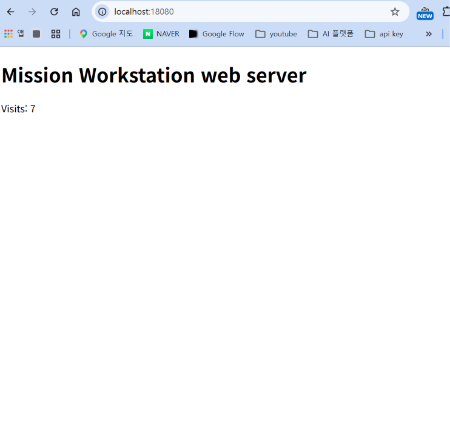
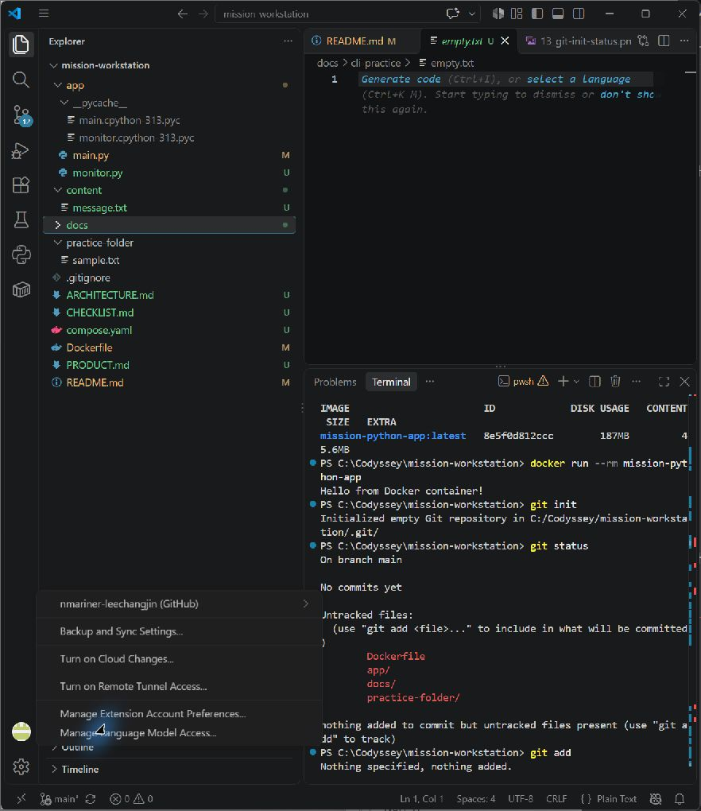

# Mission Workstation

Windows PowerShell에서 터미널·권한·Docker·Git/GitHub를 실습하고, 같은 웹 서버를 컨테이너로 재현하는 과제입니다. 명령과 결과는 이 문서에 모았습니다. 공개 [제출 저장소](https://github.com/nmariner-leechangjin/mission-workstation)의 기본 브랜치는 `main`입니다.

> 상태 기준: `VERIFIED`는 실제 실행 출력을 확인한 항목, `IMPLEMENTED`는 작성했으나 제출 증거가 더 필요한 항목, `TODO`는 수행하지 않은 항목입니다. 로컬 변경은 GitHub에 자동 반영되지 않습니다.

## 실행 환경

| 항목 | 확인 결과 |
|---|---|
| OS / 셸 / 터미널 | Windows / PowerShell / VS Code 터미널 |
| Docker | Docker Desktop, Docker CLI 29.9.2 |
| Docker 엔진 | Docker Desktop Linux 엔진 29.9.2 (`docker info` 확인) |
| Docker Compose | v5.6.1 |
| Git | 2.55.0.windows.4 |
| Python | 3.13.15 (호스트), `python:3.11-slim` (이미지 베이스) |

```powershell
docker --version
# Docker version 29.9.2, build a82e528
docker info --format '{{.ServerVersion}}|{{.OperatingSystem}}|{{.Name}}'
# 29.9.2|Docker Desktop|docker-desktop
git --version
# git version 2.55.0.windows.4
python --version
# Python 3.13.15
docker compose version
# Docker Compose version v5.6.1
```

기존 증거: [Docker 버전](docs/screenshots/06_docker-version.png), [Docker 정보](docs/screenshots/07_docker-info.png), [VS Code 터미널](docs/screenshots/01-vscode-terminal-open.png).

## 수행 항목 체크리스트

| 항목 | 상태 | 이 문서의 결과 위치 |
|---|---|---|
| 제출 저장소 / GitHub | VERIFIED | [Git과 GitHub](#git과-github) |
| 터미널 조작 | VERIFIED | [터미널 조작](#터미널-조작) |
| 파일·디렉터리 권한 | VERIFIED | [권한](#권한) |
| Docker 설치·데몬 | VERIFIED | [실행 환경](#실행-환경) |
| 이미지·컨테이너 운영 | VERIFIED | [Docker 기본 운영](#docker-기본-운영) |
| hello-world / Ubuntu | VERIFIED | [Docker 기본 운영](#docker-기본-운영) |
| Dockerfile / 커스텀 이미지 | VERIFIED | [웹 서버 이미지](#웹-서버-이미지) |
| 포트 매핑과 HTTP 응답 | VERIFIED | [포트 매핑](#포트-매핑) |
| 주소창이 보이는 브라우저 화면 | VERIFIED | [포트 매핑](#포트-매핑) |
| 바인드 마운트 | VERIFIED | [바인드 마운트](#바인드-마운트) |
| Docker 볼륨 영속성 | VERIFIED | [볼륨 영속성](#볼륨-영속성) |
| Git 설정·원격 저장소 | VERIFIED | [Git과 GitHub](#git과-github) |
| VS Code GitHub 로그인 화면 | VERIFIED | [Git과 GitHub](#git과-github) |
| Compose 단일·다중 서비스와 운영 명령 | VERIFIED | [Compose 보너스](#compose-보너스) |
| Compose 환경 변수 포트 변경 | VERIFIED | [Compose 보너스](#compose-보너스) |
| GitHub SSH 인증 | VERIFIED | [SSH 보너스](#ssh-보너스) |

## 프로젝트 파일

```text
app/main.py          HTTP 서버와 방문 횟수 저장
content/message.txt  바인드 마운트 실습용 메시지
Dockerfile           Python 베이스 커스텀 이미지
.dockerignore        빌드 컨텍스트에서 자격증명·캐시·증거 파일 제외
compose.yaml         Compose 웹·보조 서비스와 네트워크·볼륨
app/monitor.py       Compose 내부 통신 확인
PRODUCT.md           요구사항과 완료 조건
ARCHITECTURE.md      책임과 데이터 흐름
CHECKLIST.md         구현·검증 상태
docs/screenshots/    기존 화면 증거
docs/cli-practice/   터미널 실습 파일
```

## 터미널 조작

PowerShell에서 실행했습니다. `Get-ChildItem -Force`의 목록에는 숨김 폴더 `.git`이 포함됐습니다. 삭제는 실습용 `renamed.txt`에만 수행했습니다.

```powershell
Get-Location
# C:\Codyssey\mission-workstation
Get-ChildItem -Force | Select-Object Name
# .git, app, content, docs, practice-folder, .gitignore, Dockerfile, README.md 등
New-Item -ItemType Directory -Path docs/cli-practice
# docs/cli-practice 생성
Set-Location docs/cli-practice
Get-Location
# C:\Codyssey\mission-workstation\docs\cli-practice
New-Item -ItemType File -Path empty.txt
# Length: 0, Name: empty.txt
Set-Content -Path note.txt -Value 'terminal practice'
Get-Content note.txt
# terminal practice
Copy-Item note.txt copy.txt
Get-Content copy.txt
# terminal practice
Move-Item copy.txt renamed.txt
Get-ChildItem -Name
# empty.txt, note.txt, renamed.txt
Remove-Item renamed.txt
Get-ChildItem -Name
# empty.txt, note.txt
```

절대 경로 `C:\Codyssey\mission-workstation\docs\cli-practice`는 현재 위치와 무관하게 같은 장소를 가리킵니다. 상대 경로 `docs/cli-practice`는 프로젝트 루트에서 실행할 때 그 장소를 가리킵니다.

## 권한

Windows 파일 권한과 Linux `chmod`는 체계가 다르므로, Ubuntu 컨테이너 안에서 파일과 디렉터리 각각의 `r/w/x`를 실습했습니다. 아래 출력의 첫 두 줄은 변경 전, 마지막 두 줄은 변경 후입니다.

```powershell
docker run --rm ubuntu:24.04 sh -c 'mkdir /tmp/practice; echo hello > /tmp/practice/note.txt; chmod 700 /tmp/practice; chmod 600 /tmp/practice/note.txt; ls -ld /tmp/practice /tmp/practice/note.txt; chmod 755 /tmp/practice; chmod 644 /tmp/practice/note.txt; ls -ld /tmp/practice /tmp/practice/note.txt'
# drwx------ 2 root root ... /tmp/practice
# -rw------- 1 root root ... /tmp/practice/note.txt
# drwxr-xr-x 2 root root ... /tmp/practice
# -rw-r--r-- 1 root root ... /tmp/practice/note.txt
```

`r=4`, `w=2`, `x=1`을 소유자·그룹·기타 사용자별로 더합니다. `755`는 `rwx/r-x/r-x`, `644`는 `rw-/r--/r--`입니다. 디렉터리의 `x`는 그 안의 경로에 접근할 수 있는 권한입니다.

## Docker 기본 운영

`hello-world` 이미지 다운로드와 실행, Ubuntu 내부 명령을 확인했습니다.

```powershell
docker run --rm hello-world
# Status: Downloaded newer image for hello-world:latest
# Hello from Docker!
docker run --rm ubuntu:24.04 sh -c 'pwd; ls / | head -5; echo Ubuntu-container-ok'
# /
# bin
# boot
# dev
# etc
# home
# Ubuntu-container-ok
docker run -it --rm ubuntu:24.04 bash
# root@...:/# pwd → /
# root@...:/# ls / | head -5 → bin, boot, dev, etc, home
# root@...:/# echo inside-ubuntu → inside-ubuntu
# root@...:/# exit → exit
```

`-it`로 Ubuntu의 대화형 셸에 들어가 `exit`하면 그 컨테이너의 주 프로세스가 끝나고 `--rm`으로 삭제됩니다. 반면 웹 서버는 `-d`로 계속 실행했고, `docker exec`로 실행 중인 컨테이너 안의 파일을 읽었습니다. 이미지는 실행용 템플릿이고 컨테이너는 그 이미지로 만든 실행 인스턴스입니다.

```powershell
docker images --format '{{.Repository}}:{{.Tag}} {{.Size}}'
# mission-workstation:web 187MB
# mission-python-app:latest 187MB
# ubuntu:24.04 119MB
# hello-world:latest 25.9kB
docker ps -a --format '{{.Names}} {{.Status}} {{.Ports}}'
# mission-workstation-web Up ... 0.0.0.0:18080->8000/tcp
docker ps --format '{{.Names}} {{.Status}} {{.Ports}}'
# mission-workstation-web Up ... 0.0.0.0:18080->8000/tcp
docker logs mission-workstation-web
# Serving on port 8000
docker stats mission-workstation-web --no-stream --format '{{.Name}} {{.CPUPerc}} {{.MemUsage}}'
# mission-workstation-web 0.02% 17.25MiB / 3.685GiB
docker inspect --format '{{.State.Health.Status}}' mission-workstation-web
# healthy
docker stop mission-workstation-web
# mission-workstation-web
```

기존 증거: [빌드](docs/screenshots/10_docker-build-success.png), [이미지 목록](docs/screenshots/11_docker-images.png), [실행](docs/screenshots/12_docker-run-success.png), [로그](docs/screenshots/14_docker%20logs.png). 기존 스크린샷은 초기 Python 출력 예제이며, 아래 웹 서버 검증은 이번 실행 기록입니다.

## 웹 서버 이미지

선택한 기존 베이스는 `python:3.11-slim`입니다. 기존 단일 출력용 Dockerfile을 확장했습니다. `COPY`는 서버 코드와 기본 메시지를 넣고, `ENV`는 포트·메시지·데이터 파일 위치를 설정하며, `EXPOSE`는 컨테이너 포트를 문서화하고, `HEALTHCHECK`는 `/health` 응답을 확인합니다. 실제 포트 공개는 `docker run -p`가 담당합니다.

```powershell
docker build -t mission-workstation:web .
# [3/4] COPY app/ /app/ DONE
# [4/4] COPY content/ /app/content/ DONE
# naming to docker.io/library/mission-workstation:web done
```

설계 설명은 [ARCHITECTURE.md](ARCHITECTURE.md), 실행 코드는 [app/main.py](app/main.py), 이미지 정의는 [Dockerfile](Dockerfile)에 있습니다.

## 포트 매핑

컨테이너의 8000번 포트는 호스트에서 바로 접근할 수 없으므로 `-p 18080:8000`으로 연결했습니다. 주소는 `http://localhost:18080/`입니다.

```powershell
docker volume create mission-workstation-data
# mission-workstation-data
docker run -d --name mission-workstation-web -p 18080:8000 --mount type=bind,source=C:\Codyssey\mission-workstation\content\message.txt,target=/app/content/message.txt --mount type=volume,source=mission-workstation-data,target=/data mission-workstation:web
# 56a4021b27be10cb36ada123bb03935ce85638d59ffd7229310182874b715ad6
curl.exe -sS http://localhost:18080/
# <!doctype html>...<h1>Mission Workstation web server</h1><p>Visits: 1</p></html>
curl.exe -sS http://localhost:18080/health
# ok
```

위 `curl`은 HTTP 접속 성공 증거입니다. 아래 화면에는 주소창의 `localhost:18080`과 웹 서버 응답이 함께 보입니다.



## 바인드 마운트

컨테이너를 재빌드하지 않고 Windows 호스트 파일을 바꾸자, 다음 HTTP 응답에 새 메시지가 나타났습니다. 이후 파일은 원래 내용으로 복원했습니다.

```powershell
Get-Content content/message.txt
# Mission Workstation web server
Set-Content -LiteralPath content/message.txt -Value 'Updated from Windows host'
Get-Content content/message.txt
# Updated from Windows host
curl.exe -sS http://localhost:18080/
# <!doctype html>...<h1>Updated from Windows host</h1><p>Visits: 2</p></html>
Set-Content -LiteralPath content/message.txt -Value 'Mission Workstation web server'
```

## 볼륨 영속성

방문 횟수는 컨테이너 밖의 named volume에 저장했습니다. 실습 컨테이너를 삭제한 뒤 새 Ubuntu 컨테이너에 같은 볼륨을 붙여 값 `2`가 유지됨을 확인했습니다. Docker 볼륨은 컨테이너 삭제와 별개로 남습니다.

```powershell
docker exec mission-workstation-web cat /data/visits.txt
# 2
docker stop mission-workstation-web
# mission-workstation-web
docker rm mission-workstation-web
# mission-workstation-web
docker run --rm --mount type=volume,source=mission-workstation-data,target=/data ubuntu:24.04 cat /data/visits.txt
# 2
docker run -d --name mission-workstation-web -p 18080:8000 --mount type=bind,source=C:\Codyssey\mission-workstation\content\message.txt,target=/app/content/message.txt --mount type=volume,source=mission-workstation-data,target=/data mission-workstation:web
curl.exe -sS http://localhost:18080/
# <!doctype html>...<h1>Mission Workstation web server</h1><p>Visits: 4</p></html>
```

## Compose 보너스

[`compose.yaml`](compose.yaml)에 웹 서버의 이미지·포트·마운트·볼륨과 보조 서비스의 설정을 기록했습니다. 긴 `docker run` 명령을 파일로 저장해 같은 설정을 다시 실행할 수 있습니다. `monitor`는 Compose 네트워크에서 서비스 이름 `web`을 DNS 이름으로 사용합니다.

단일 서비스 실행과 운영 명령 결과:

```powershell
docker compose config
# web: 18081 -> 8000, bind mount, web_data volume
# monitor: TARGET_URL=http://web:8000/health
docker compose up -d --build web
# Container mission-workstation-web-1 Started
docker compose ps
# mission-workstation-web-1  Up ...  0.0.0.0:18081->8000/tcp
curl.exe -sS http://localhost:18081/
# <!doctype html>...<h1>Mission Workstation web server</h1><p>Visits: 1</p></html>
docker compose logs --tail 5 web
# web-1 | Serving on port 8000
```

두 서비스 실행과 내부 통신 결과:

```powershell
docker compose up -d monitor
# Container mission-workstation-web-1 Healthy
# Container mission-workstation-monitor-1 Started
docker compose ps
# mission-workstation-monitor-1 Up ...
# mission-workstation-web-1 Up ... (healthy) 0.0.0.0:18081->8000/tcp
docker compose logs --tail 5 monitor
# monitor-1 | GET http://web:8000/health -> ok
docker compose exec -T monitor python -c "import urllib.request; print(urllib.request.urlopen('http://web:8000/health').read().decode().strip())"
# ok
```

처음에는 보조 서비스가 웹 이미지의 헬스체크를 상속해 `health: starting`으로 표시됐습니다. `monitor`는 HTTP 서버가 아니므로 Compose에서 그 헬스체크를 비활성화하고 재생성한 뒤 `Up` 상태를 확인했습니다.

환경 변수로 컨테이너 포트를 `8010`, 호스트 포트를 `18082`로 변경했습니다. 서버 코드 변경 없이 `PORT`를 주입하고, Dockerfile의 헬스체크도 해당 포트에 맞춰 동작했습니다. 이 실습 후 `down`으로 컨테이너를 종료하고 기본 포트로 다시 실행했습니다. 볼륨은 `down` 후에도 남아 방문 횟수가 `2`로 이어졌습니다.

```powershell
$env:APP_PORT='8010'
$env:HOST_PORT='18082'
docker compose up -d --build --force-recreate
docker compose ps
# mission-workstation-web-1 Up ... (healthy) 0.0.0.0:18082->8010/tcp
curl.exe -sS http://localhost:18082/health
# ok
docker compose logs --tail 2 monitor
# monitor-1 | GET http://web:8010/health -> ok
docker compose down
# Container mission-workstation-monitor-1 Removed
# Container mission-workstation-web-1 Removed
# Network mission-workstation_default Removed
Remove-Item Env:APP_PORT
Remove-Item Env:HOST_PORT
docker compose up -d
curl.exe -sS http://localhost:18081/
# <!doctype html>...<p>Visits: 2</p></html>
```

## Git과 GitHub

Git은 로컬 변경 이력을 관리하고 GitHub는 저장소를 원격에서 공유합니다. `user.name`·`user.email`은 설정돼 있고 기본 브랜치는 `main`입니다. 공개 문서에는 개인 이메일을 기록하지 않았습니다.

```powershell
git config --list | ForEach-Object { if ($_ -match '^user\.name=') { 'user.name=[redacted]' } elseif ($_ -match '^user\.email=') { 'user.email=[redacted]' } elseif ($_ -match '^init\.defaultbranch=') { $_ } }
# init.defaultbranch=main
# user.name=[redacted]
# user.email=[redacted]
git branch --show-current
# main
git remote get-url origin
# https://github.com/nmariner-leechangjin/mission-workstation.git
```

기존 증거: [Git 초기화·상태](docs/screenshots/13_git-init-status.png). 아래 VS Code 계정 메뉴에는 `nmariner-leechangjin (GitHub)` 로그인 상태와 `mission-workstation` 작업 폴더가 함께 보입니다. 이 문서의 로컬 수정은 아직 push하지 않았습니다.



## SSH 보너스

사용자가 암호 문구를 설정해 SSH 키를 생성하고 정확한 공개키를 GitHub 계정에 등록했습니다. 로컬 공개키 지문은 `SHA256:SDJVmldeW+Wup6f8K+C3G1RPGPto8dJtcLY5GEvQlUs`입니다. GitHub 서버의 Ed25519 지문을 [공식 지문](https://docs.github.com/en/authentication/keeping-your-account-and-data-secure/githubs-ssh-key-fingerprints) `SHA256:+DiY3wvvV6TuJJhbpZisF/zLDA0zPMSvHdkr4UvCOqU`와 비교해 일치함을 확인하고 `known_hosts`에 추가했습니다. 사용자가 다음 명령으로 GitHub SSH 인증 성공을 확인했습니다. 개인키는 저장소에 넣지 않습니다.

```powershell
& 'C:\Program Files\Git\usr\bin\ssh-keyscan.exe' -T 10 -t ed25519 github.com 2>$null | & 'C:\Program Files\Git\usr\bin\ssh-keygen.exe' -lf - -E sha256
# 256 SHA256:+DiY3wvvV6TuJJhbpZisF/zLDA0zPMSvHdkr4UvCOqU github.com (ED25519)
ssh -o IdentitiesOnly=yes -i "$env:USERPROFILE\\.ssh\\id_ed25519" -T git@github.com
# Hi nmariner-leechangjin! You've successfully authenticated, but GitHub does not provide shell access.
```

사용자에게 안내한 키 생성·등록 절차와 검증 명령은 다음과 같습니다. `ssh-keygen`의 암호 문구는 사용자가 직접 입력했으며 채팅이나 스크린샷에 남기지 않았습니다.

```powershell
ssh-keygen -t ed25519 -C "mission-workstation" -f "$env:USERPROFILE\.ssh\id_ed25519"
Get-Content "$env:USERPROFILE\.ssh\id_ed25519.pub" | Set-Clipboard
# GitHub Settings → SSH and GPG keys → New SSH key에서 공개키만 등록 (사용자 수행)
ssh -T git@github.com
# 인증 성공 후 SSH 원격 주소로 전환
git remote set-url origin git@github.com:nmariner-leechangjin/mission-workstation.git
git remote -v
git ls-remote origin HEAD
```

## 트러블슈팅

1. **Docker API 연결 권한 거부** — 일반 실행 환경에서 `docker info`가 `permission denied ... dockerDesktopLinuxEngine`을 반환했습니다. 데몬 중단 또는 실행 환경의 파이프 접근 제한을 가설로 두고, 같은 명령을 허용된 로컬 실행 권한으로 재실행했습니다. `29.9.2|Docker Desktop|docker-desktop`이 출력되어 데몬은 동작 중이고 처음의 실행 권한이 원인이었음을 확인했습니다.
2. **로컬 HTTP 접속 실패** — 제한된 실행 환경의 `curl.exe http://localhost:18080/`는 연결 오류를 냈습니다. 컨테이너 종료 또는 로컬 네트워크 접근 제한을 가설로 두고 `docker ps -a`와 `docker logs`로 서버 실행·포트 연결을 확인했습니다. 로컬 접근이 허용된 실행 권한에서 같은 URL로 HTML과 `/health`의 `ok`를 받아 네트워크 접근 경계임을 확인했습니다.
3. **Docker Desktop 최초 설치 실패** — 기존 [설치 오류 화면](docs/screenshots/docsscreenshots06_docker-install-prerequisite-failed.png)에 `Virtual Machine Platform` 기능이 비활성화돼 있고 사용자별 설치에서 관리자 권한으로 활성화할 수 없다고 표시됩니다. 원인 가설은 Windows 가상화 기능 미설정입니다. 이후 [설치 성공 화면](docs/screenshots/Docker%EC%84%A4%EC%B9%98%20%EC%84%B1%EA%B3%B5.png)과 `docker info` 성공으로 현재 설치·데몬 동작을 확인했습니다. 중간에 수행한 관리자 설정 절차의 명령 기록은 없어 특정 조치를 성공 원인으로 단정하지 않습니다.
4. **SSH 공개키 불일치 해결** — 처음에는 GitHub에 다른 공개키가 등록돼 `Permission denied (publickey)`가 반환됐습니다. 로컬 `.pub` 파일을 다시 복사해 GitHub에 등록한 뒤, `ssh -o IdentitiesOnly=yes -i "$env:USERPROFILE\\.ssh\\id_ed25519" -T git@github.com`에서 사용자 인증 성공 메시지를 확인했습니다.

## 남은 제출 증거

- 로컬 변경을 검토한 뒤 사용자 요청에 따라 commit/push하고, 공개 README에서 이미지와 링크가 실제로 열리는지 최종 확인하기.
- SSH 보너스의 대화형 인증 성공, SSH 원격 주소 전환, `git push origin main` 결과 `Everything up-to-date`를 확인했다.

## 보안

인증 정보는 코드·출력·스크린샷에 기록하지 않습니다. `.env`와 Python 캐시 파일은 `.gitignore`로, 빌드 컨텍스트의 `.env`·`.ssh`·개인키·캐시·문서·스크린샷은 `.dockerignore`로 제외합니다. 제출 전 텍스트 파일의 일반적인 토큰·개인키·이메일 패턴을 검색했으며 일치하는 파일은 없었습니다. 스크린샷 22개를 눈으로 확인했으며 토큰·비밀번호·인증 코드는 발견하지 못했습니다. 기존 이미지에는 공개 GitHub 사용자명과 로컬 Windows 사용자명이 보입니다.
